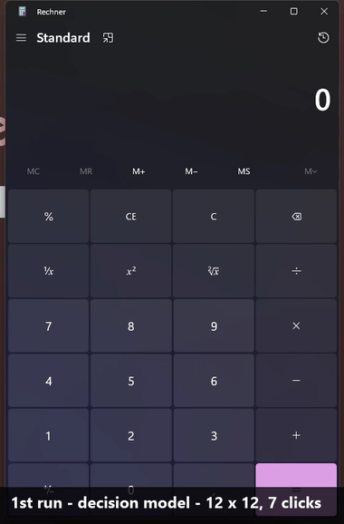

# nitrolane ⚡

[](LICENSE)


[](https://github.com/koopmannleon19977-cmyk/nitrolane/releases)

**The fast lane for browser and desktop automation.** One JSON request in, one
*verified* JSON result out. Instead of paying a frontier LLM for every click,
nitrolane lets a decision model (TypeSafe JEV) choose each action from the elements
the UI actually offers — ~0.3 s per decision, no screenshots, no invented text.
Anything it has done once and verified, it replays later with **zero model calls**.

```text
planner (you / any LLM)                nitrolane                     UI
───────────────────────   subtask     ──────────────   action       ───
goal + inputs + check  ─────────────►  JEV decisions ─────────────►  Chrome / Windows app
                       ◄─────────────  ~0.3 s each   ◄─────────────  DOM / UIA tree
        verified JSON                    + replay cache
```

## Measured, not promised

28-task battery (browser + desktop, every run independently checked against the real
UI state, Windows 11, 2026-10-15, judged with a frozen rubric):

| Verdict | Count |
|---|---:|
| Verified success | 21 |
| Correct handback (missing input asked, forbidden action refused) | 6 |
| Missed a feasible task ("7 plus 8" as a plain goal; as `steps`: 3/3) | 1 |
| False success | **0** |
| Constraint violation | **0** |

Plus 11 v0.4 feature runs (background focus, self-healing, ordered steps): all verified.

| Task | Model loop | Replay (0 model calls) |
|---|---:|---:|
| 6-field web form + submit | 4.7 s | **1.4 s** |
| Notepad: set document text | 4.0 s | **0.46 s** |
| Calculator: 7 button clicks | 6.4 s | **3.8 s** |

Browser median over the battery: 1.4 s per subtask · desktop median: 5.0 s.
Reproduce them yourself: `tests/battery.py` (see [Tests](#tests)).

## Demo



*Real recording: first run 7 decisions (6.6 s), second run the cached template (2.6 s,
0 model calls) — both in the background, the user's window kept focus.*

```bash
"$ARC" nitrolane.py <<'EOF'
{"target":"browser","url":"https://httpbin.org/forms/post",
 "subtask":{"goal":"Fill the pizza order form and submit it",
  "inputs":{"name":"Max Muster","phone":"0123456","email":"max@example.com"},
  "verification":["The order was submitted and the response page is shown"],
  "constraints":["Choose size Medium","Select topping Bacon only"],"max_actions":15},
 "check":"document.body.innerText.includes('\"size\": \"medium\"')",
 "cache":true}
EOF
```

```json
{
 "status": "SUBTASK_COMPLETE",
 "actions": 6,
 "steps": [
  "TYPE_TEXT 'Customer name:' (replay)",
  "CLICK 'Submit order' (replay)"
 ],
 "cache": "hit",
 "check": true,
 "sec": { "setup": 0.72, "run": 1.31 }
}
```

Desktop works the same way: `"target":"desktop","app":{"title":"Rechner","launch":"calc.exe"}`.

## What nitrolane adds

Everything in this repo is nitrolane's own engineering on top of two MIT backends
(credits below) — the backends are downloaded at install time, never vendored:

- **The lane itself** (`nitrolane.py`): request/result contract, warm-Chrome
  management (own profile, never the user's), UWP window resolution, minimized-window
  restore, independent `check`/`extract` verification in the same call.
- **Record-and-replay cache**: verified trajectories are stored as *parameterized
  templates* (input values become variables) and re-executed by element name +
  geometry with semantic guards and probe-based settling — the same workflow with
  new data still costs zero model calls. **Self-healing:** when a recorded element was
  renamed or translated, only that step costs one decision (gate 0.6) and the fixed
  name is written back — measured: German→English-renamed calculator template healed
  in 3.7 s, next run a 2.6 s zero-model replay again. A step that cannot be healed
  hands the reached state to the model and the template is rebuilt; a failed
  post-replay check deletes the entry.
- **Provider freedom**: TypeSafe JEV by default, OpenAI Decisions, or any
  OpenAI-compatible chat endpoint (OpenAI, OpenRouter, Ollama, LM Studio) behind
  one finite-choice transport — plus an MCP server (`nitrolane_mcp.py`) and a
  `doctor` mode for instant setup diagnostics (`doctor --deep` sends one real choice
  decision, so a broken key/endpoint/model fails here instead of on your first run).
- **True background desktop** (with [cua-driver](https://github.com/trycua/cua) on
  PATH): clicks and values on named elements are performed by the cua-driver daemon.
  Measured: the same UIA Invoke from nitrolane's own process let Calculator and
  Notepad grab the foreground (271 and 109 foreign-foreground samples at 10 ms);
  through the daemon, which holds no foreground rights, **0 samples** — your window
  never loses focus. Costs ~0.3 s per action; `"background": false` opts out.
  Without cua-driver: pattern-first UIA, foreground restored at the end.
- **Ordered steps** (`"steps": ["Click 7", "Click plus", ...]`): order-sensitive
  goals run as one decision per step. Measured: "7 plus 8" as a plain goal 0/3
  (choice models pick goal parts in any order; order hints in the goal 1/3, 0/3),
  as steps **3/3**. The final `check` is the verdict.
- **Transition verification**: optional per-step expectations stop a run whose
  intermediate state is wrong — even if the final screen would have looked right.
- **Parallel fleet** (`nitrolane_fleet.py`): many subtasks in one call — browser tabs
  run in parallel, desktop tasks stay sequential (one foreground). Measured: 4 wiki
  tasks in **10.2 s wall instead of 17.0 s serial**.
- **Demo recorder** (`nitrolane_record.py`): demonstrate a workflow once; nitrolane
  records clicks (resolved to element names), typed values and drop-down picks as a
  *parameterized* template and later replays it with new data — verified end to end
  (4 recorded steps → replay with zero model calls).
- **OCR last resort** (`ocr_capture.ps1`): for pixels-only UIs (canvas, custom-drawn
  controls) Windows.Media.Ocr finds the text and clicks it; UIA always wins when it
  can. Verified clicking a Tk canvas label (2.7 s).
- **Bring your own browser** (`"cdp": "http://127.0.0.1:9222"`): attach to any Chrome
  started with `--remote-debugging-port` (e.g. one you are logged into) instead of
  nitrolane's own profile. Opt-in only — the subtask then acts as that session.
- **A faster Windows backend** (`patches/`): UIA observation as a single CacheRequest
  subtree fetch (350 ms → 55 ms), exact layout-independent typing
  (ValuePattern first, Unicode `SendInput` fallback), native drop-down selection,
  pattern-first execution, one observe saved per action.
- **A safer decision loop**: risky controls are refused *by name* instead of hidden
  (hiding made the model substitute-click the wrong button), separate confidence
  gates for actions (0.35) and completions (0.30) — derived from battery data:
  multi-field tasks split confidence across equally valid first steps, so the gate
  sits below correct-but-ambiguous actions and above the observed wrong targets.
- **The verification methodology**: a 28-task battery where success is only counted
  when an independent check against the real UI agrees (`tests/`).

Details and per-change measurements: [`patches/README.md`](patches/README.md).

## Install (Windows 11)

Prerequisites: Python 3.12+, Chrome, git, and a decision provider —
a [TypeSafe](https://typesafe.com) key (`TYPESAFE_API_KEY`, default), an OpenAI
Decisions key, or any OpenAI-compatible chat endpoint (set
`NITROLANE_PROVIDER=chat`, `NITROLANE_MODEL`, `NITROLANE_BASE_URL`). Optional:
[cua-driver](https://github.com/trycua/cua) on `PATH` for background desktop control
(`doctor` reports `cua_driver_background`).

One command (PowerShell):

```powershell
irm https://raw.githubusercontent.com/koopmannleon19977-cmyk/nitrolane/main/install.ps1 | iex
```

Or manually:

```powershell
git clone https://github.com/koopmannleon19977-cmyk/nitrolane.git
cd nitrolane
.\setup.ps1   # pinned backend + nitrolane patches + venv, then smoke test and backend test suite
vendor\arc-cua-windows\.venv\Scripts\python.exe nitrolane.py doctor
```

## The contract

- **Bounded subtasks.** You supply `goal`, literal `inputs`, `verification` criteria
  and `constraints`. The model only chooses among offered elements/operations; it can
  never invent text. Missing value → `NEEDS_INPUT` naming the field.
- **Independent check.** `check` (JS expression in the browser, expected text on the
  desktop) verifies the real UI state after the run — success is never taken on faith.
- **Safety gates.** Delete/send/purchase/close controls are refused by name unless
  opted in via `allowed_risks`. Low-confidence decisions hand back (`NEEDS_AGENT`)
  instead of guessing. Secrets stay hidden from the model via `secret_inputs`.
- **Browser:** one warm headless Chrome, CDP, 1280×2400 viewport so most content
  needs no scrolling decisions. **Desktop:** Windows UIA; with cua-driver, clicks and
  values run in the background without touching your focus; keys and unnamed or
  ambiguous targets briefly come to the front, and your original window gets focus back.

Full contract and hard-won authoring rules (from the battery):
[`omp/skills/nitrolane/SKILL.md`](omp/skills/nitrolane/SKILL.md). The `omp/` folder
also ships ready-made [Oh My Pi](https://omp.sh) agents and a delegation rule that
route bounded subtasks to nitrolane first.

## Limitations

Preview quality, measured on one Windows 11 machine (German UI). Not for logins/2FA,
payments, uploads, drag & drop or cross-origin iframes; canvas only via the OCR last
resort. Keys (Enter, shortcuts) still need the foreground: PostMessage keys into WinUI
Notepad landed only in some focus states and modifier chords not at all (measured), so
nitrolane does not send them in the background. Natural-language order ("7 plus 8")
is unreliable with choice models — use `steps`. The default JEV provider is a hosted
service — or bring your own model (see Install).

## Tests & benchmark

```powershell
# fixture server, in tests/pages:  python -m http.server 8765 --bind 127.0.0.1
vendor\arc-cua-windows\.venv\Scripts\python.exe tests\battery.py   # 28-task regression battery
vendor\arc-cua-windows\.venv\Scripts\python.exe tests\bench.py     # public micro-benchmark -> tests/bench_result.json
```

## Use it from your agent (MCP)

`nitrolane_mcp.py` exposes `nitrolane_run` and `nitrolane_doctor` over stdio MCP —
point Claude Code, Cursor, Codex or omp at
`vendor\arc-cua-windows\.venv\Scripts\python.exe nitrolane_mcp.py` and the agent
gets the whole lane as one tool call.

## Roadmap

- Background keys through a verified input channel
- Trajectory cache sharing across machines
- Public benchmark runs (OSWorld/WebArena-style scoring)

## Credits & License

nitrolane is MIT-licensed (see [`LICENSE`](LICENSE)). It executes through
[arc-cua](https://github.com/shhivv/arc-cua) by Shiv Shanmugam (MIT) and its Windows
fork [arc-cua-windows](https://github.com/GreenKeewi/arc-cua-windows) (MIT), downloaded
pinned at install time. Full attribution: [`NOTICE`](NOTICE).
